# 🎯 파이썬·Git 기초 퀴즈 게임

> Codyssey E1-2 | 컴퓨터에게 명령 내리는 말(파이썬) 처음 배우기

## 1. 프로젝트 개요

Python 기본 문법과 객체지향 프로그래밍을 학습하기 위해 개발한 콘솔 기반 퀴즈 게임입니다.

사용자는 퀴즈를 풀거나 새로운 문제를 추가·삭제할 수 있으며, 최고 점수와 게임 기록을 확인할 수 있습니다.

JSON 파일을 활용하여 프로그램 종료 후에도 데이터가 유지되도록 구현했습니다. 개발 과정은 Git과 GitHub로 관리했습니다.

### 개발 환경

- Python 3.10 이상
- Visual Studio Code
- Git / GitHub
- 외부 라이브러리 없음 (Python 표준 라이브러리 사용)

## 2. 퀴즈 주제 및 선정 이유

**주제: 파이썬·Git 기초 지식**

프로그래밍 입문 과정에서 학습한 내용을 직접 퀴즈 문제로 제작하고 반복 학습하기 위해 선정했습니다.

Python의 변수, 자료형, 조건문, 반복문, 클래스와 Git의 주요 명령어 등을 다룹니다.

기본 퀴즈는 총 10문제이며, 사용자 등록 기능으로 문제를 추가할 수 있습니다.

## 3. 주요 기능

| 메뉴 | 기능 | 설명 |
|---|---|---|
| 1 | 퀴즈 풀기 | 랜덤 출제, 문제 수 선택, 정답 판정 |
| 2 | 퀴즈 추가 | 문제, 선택지, 정답, 힌트 등록 |
| 3 | 퀴즈 목록 | 등록된 문제와 선택지 조회 |
| 4 | 퀴즈 삭제 | 번호 선택, 삭제 확인, 파일 반영 |
| 5 | 최고 점수 확인 | 최고 점수 및 상세 기록 조회 |
| 6 | 게임 기록 조회 | 날짜별 게임 결과를 최신순 표시 |
| 7 | 종료 | 데이터 저장 후 정상 종료 |

### 추가 구현 기능

- 랜덤 출제: `random.sample()`으로 중복 없이 문제 선택
- 문제 수 선택: 전체 문제 중 원하는 개수 선택
- 힌트 제공: 정답 입력 시 `h` 입력
- 힌트 감점: 힌트 사용 후 정답이면 기본 배점의 50% 획득
- 점수 히스토리: 게임 날짜, 문제 수, 정답 수, 점수 저장
- 오류 처리: 잘못된 입력, Ctrl+C, EOF 및 JSON 파일 손상 대응

### 점수 계산

100점 만점을 기준으로 계산합니다.

- 힌트 없이 정답: 문제당 1점
- 힌트 사용 후 정답: 문제당 0.5점
- 오답: 0점

최종 점수 = (획득한 배점 합계 / 출제 문제 수) × 100

## 4. 설치 및 실행 방법

### GitHub 저장소 복제

```bash
git clone https://github.com/neoinkyu/E1-2.git
cd E1-2
```

### 프로그램 실행

```bash
python main.py
```

Python 3.10 이상이 설치되어 있어야 합니다.

별도의 패키지 설치 과정은 필요하지 않습니다.

### 이용 방법

1. 메인 메뉴에서 1~7번 선택
2. 퀴즈 풀기에서 원하는 문제 수 입력
3. 정답 번호(1~4) 입력 또는 `h`로 힌트 확인
4. 게임 완료 후 결과 및 최고 점수 확인
5. 7번 선택 시 데이터 저장 후 종료

## 5. 프로젝트 파일 구조

```text
E1-2/
├── main.py
├── quiz.py
├── quiz_game.py
├── quiz_play.py
├── default_quizzes.py
├── state.json
├── README.md
├── .gitignore
└── docs/
    └── screenshots/
```

| 파일 | 역할 |
|---|---|
| `main.py` | 메인 메뉴 및 프로그램 실행 |
| `quiz.py` | 개별 퀴즈를 관리하는 Quiz 클래스 |
| `quiz_game.py` | 게임 전체 관리, 등록·삭제·저장·조회 |
| `quiz_play.py` | 출제, 입력 처리, 힌트, 점수 계산 |
| `default_quizzes.py` | 기본 퀴즈 10개 |
| `state.json` | 퀴즈, 최고 점수, 게임 기록 저장 |
| `.gitignore` | Git 관리 제외 파일 설정 |
| `docs/screenshots/` | 실행 및 Git 실습 증빙 이미지 |

`state.json`은 프로그램 실행 과정에서 생성되며, GitHub에는 업로드하지 않습니다.

## 6. 데이터 저장 방식

프로젝트 루트의 `state.json`에 UTF-8 인코딩으로 데이터를 저장합니다.

### 데이터 구조 예시

```json
{
  "quizzes": [
    {
      "question": "화면에 글자를 출력하는 파이썬 함수는?",
      "choices": ["input()", "print()", "open()", "type()"],
      "answer": 2,
      "hint": "입력과 출력은 서로 다른 함수가 담당합니다."
    }
  ],
  "best_score": 75,
  "history": [
    {
      "played_at": "2026-11-03T09:00:00+09:00",
      "score": 75,
      "correct_count": 2,
      "total_questions": 2,
      "hint_used_count": 1
    }
  ]
}
```

위 데이터는 구조 설명용 예시입니다.

- `quizzes`: 문제, 선택지, 정답, 힌트 목록
- `best_score`: 최고 점수 (100점 만점)
- `history`: 게임 완료 시각과 성적 기록

파일이 없으면 기본 퀴즈를 사용합니다. 읽을 수 없는 파일은 가능한 경우 백업한 뒤 기본 데이터로 시작합니다.

`state.json`은 `.gitignore`에 포함되어 있으므로 PC마다 게임 기록이 별도로 관리됩니다.

## 7. 프로그램 실행 화면

### 메인 메뉴

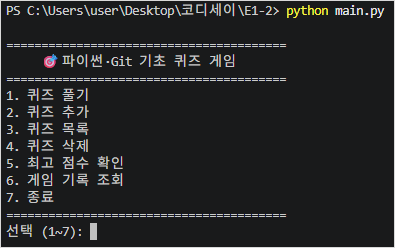

### 퀴즈 풀기

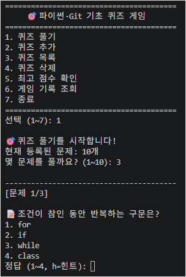

### 힌트 기능

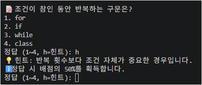

### 게임 결과

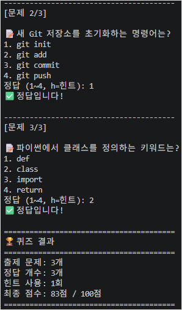

### 퀴즈 추가

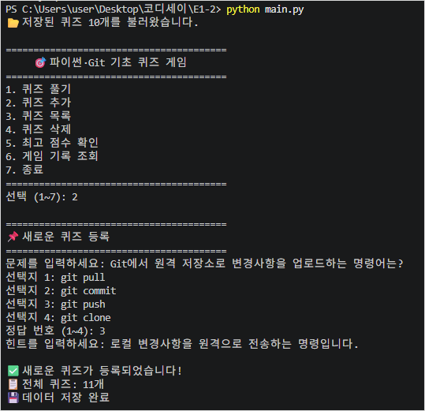

### 퀴즈 목록

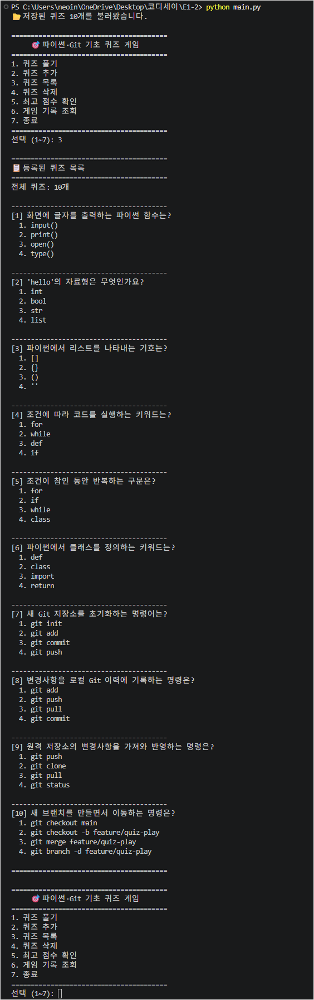

### 퀴즈 삭제

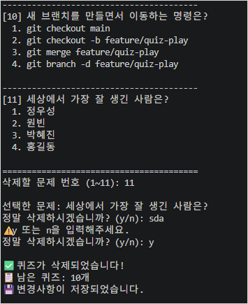

### 최고 점수

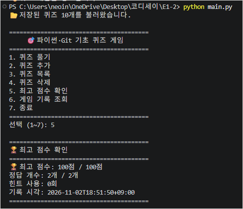

### 게임 기록

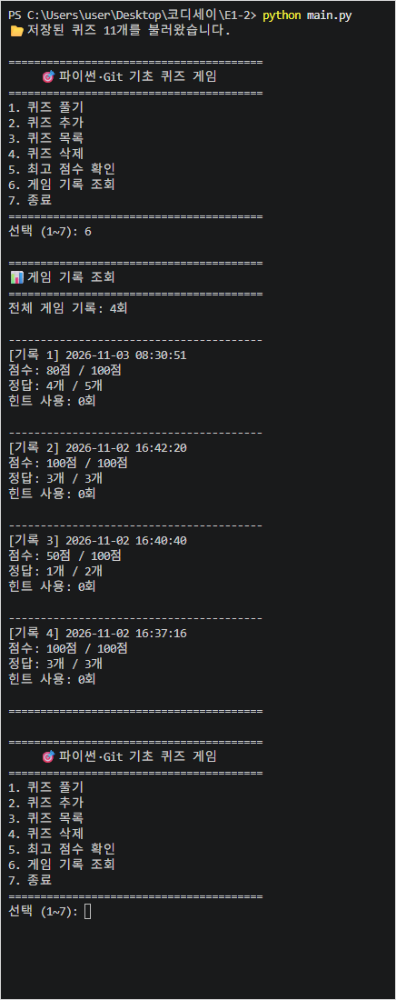

### 데이터 영속성

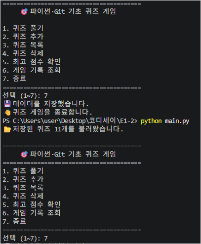

### 입력 오류 처리

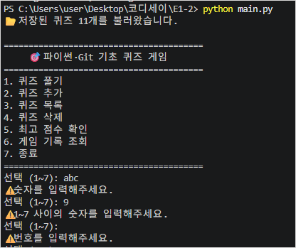

## 8. Git 및 GitHub 활용

기능 단위로 코드를 작성하고 테스트한 뒤 커밋했습니다.

개발 과정에서 다음 Git 명령어를 학습하고 활용했습니다.

`init`, `add`, `commit`, `push`, `pull`, `checkout`, `merge`

퀴즈 출제 기능은 `feature/quiz-play` 브랜치에서 개발한 뒤 `main` 브랜치에 병합했습니다.

### 브랜치 병합 기록

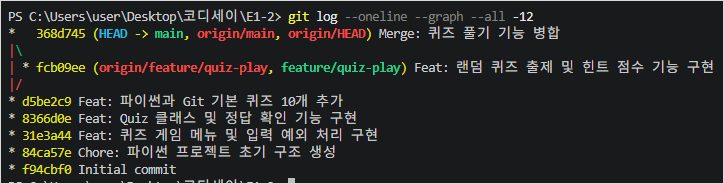

## 9. 학습 내용 및 개발 경험

이번 프로젝트를 통해 다음 내용을 학습했습니다.

- 변수, 자료형, 조건문, 반복문, 함수
- 클래스, 객체, 속성, 메서드
- 리스트와 딕셔너리를 활용한 데이터 관리
- JSON 파일 입출력 및 데이터 영속성
- try/except를 활용한 예외 처리
- Git의 버전 관리 및 브랜치 병합
- GitHub를 통한 여러 PC 간 개발 코드 동기화

특히 프로그램의 기능을 역할별로 나누고, 구현한 기능을 단계별로 검증하면서 개발하는 과정을 경험했습니다.

## 10. 개발 저장소

[GitHub - neoinkyu/E1-2](https://github.com/neoinkyu/E1-2)

## 11. Git clone 및 pull 실습

별도 디렉터리에 저장소를 복제하여 README를 수정하고 커밋했습니다.


### Git clone 및 pull 실습 결과

기존 작업 폴더와 별도로 GitHub 저장소를 복제했습니다.
복제한 저장소에서 README를 수정하고 Commit·Push한 뒤,
기존 작업 폴더에서 Pull하여 변경사항이 반영되는 것을 확인했습니다.

**Git clone 성공 화면**

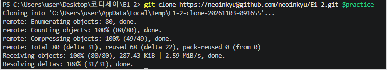

**Git pull 성공 화면**

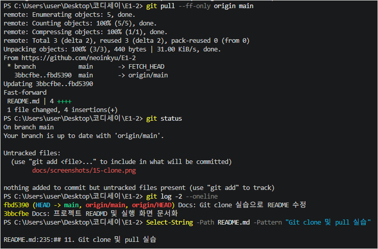

### 전체 Git 커밋 및 브랜치 이력

기능별 커밋을 수행하고, feature 브랜치에서 개발한
퀴즈 출제 기능을 main 브랜치에 병합했습니다.

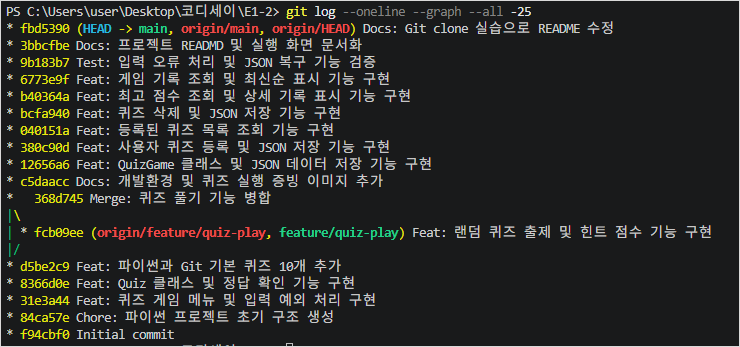


## 12. Git 커밋 이력 및 커밋 메시지 규칙

### 12.1 커밋 개수 증빙

2026년 11월 3일 README 보완 작업 이전 기준,
GitHub `main` 브랜치에는 총 **19개의 커밋**이 존재합니다.
따라서 과제에서 요구하는 10개 이상의 커밋 조건을 충족합니다.

커밋 개수 확인 명령어:

```bash
git rev-list --count HEAD
```

커밋 이력 조회 명령어:

```bash
git log --oneline
```

실제 커밋 이력 일부:

```text
dc61f3e Docs: Git clone pull 실습 증빙 및 README 최종 정리
9f9321a Docs: Git clone pull 및 커밋 이력 증빙 추가
fbd5390 Docs: Git clone 실습으로 README 수정
3bbcfbe Docs: 프로젝트 READMD 및 실행 화면 문서화
9b183b7 Test: 입력 오류 처리 및 JSON 복구 기능 검증
6773e9f Feat: 게임 기록 조회 및 최신순 표시 기능 구현
b40364a Feat: 최고 점수 조회 및 상세 기록 표시 기능 구현
bcfa940 Feat: 퀴즈 삭제 및 JSON 저장 기능 구현
040151a Feat: 등록된 퀴즈 목록 조회 기능 구현
380c90d Feat: 사용자 퀴즈 등록 및 JSON 저장 기능 구현
```

전체 커밋 이력:
[GitHub Commits](https://github.com/neoinkyu/E1-2/commits/main)

브랜치 병합을 포함한 커밋 그래프:


### 12.2 커밋 메시지 작성 규칙

본 프로젝트에서는 변경 목적을 쉽게 식별할 수 있도록
다음과 같은 커밋 메시지 형식을 사용했습니다.

**제목 형식: `Type: 변경 내용 요약`**

| Type | 용도 | 예시 |
|---|---|---|
| Feat | 새로운 기능 구현 | `Feat: 퀴즈 삭제 및 JSON 저장 기능 구현` |
| Fix | 오류 수정 | `Fix: 입력값 검증 오류 수정` |
| Docs | README 및 문서 수정 | `Docs: 개발환경 및 퀴즈 실행 증빙 이미지 추가` |
| Test | 테스트 및 검증 | `Test: 입력 오류 처리 및 JSON 복구 기능 검증` |
| Chore | 개발 환경 및 구조 정리 | `Chore: 파이썬 프로젝트 초기 구조 생성` |
| Merge | 브랜치 병합 | `Merge: 퀴즈 풀기 기능 병합` |

작성 원칙:

1. 제목은 `Type: 설명` 형식으로 작성합니다.
2. 변경한 기능이나 목적을 구체적이고 간결하게 표현합니다.
3. 하나의 커밋에는 가급적 하나의 작업 목적을 담습니다.
4. 복잡한 변경은 제목 아래 빈 줄을 두고 본문에 변경 이유와 검증 결과를 설명할 수 있습니다.
5. 수정 이력이 추적되도록 기능 구현, 테스트, 문서 변경을 구분합니다.

최초 저장소 생성 커밋인 `Initial commit`은 초기화 시점의 예외입니다.

---

## 13. 객체지향 설계 및 클래스 선택 이유

### 13.1 클래스를 사용한 이유

퀴즈 게임은 개별 문제의 정보와 게임 전체의 상태를 구분하여
관리해야 하므로 `Quiz`와 `QuizGame` 클래스를 사용했습니다.

**Quiz 클래스 (`quiz.py`)**

개별 문제의 질문, 선택지, 정답, 힌트를 하나의 객체로 관리합니다.

- `__init__()`: 문제 데이터 생성 및 유효성 검사
- `display()`: 문제와 선택지 출력
- `is_correct()`: 정답 여부 판정
- `show_hint()`: 힌트 출력

**QuizGame 클래스 (`quiz_game.py`)**

여러 퀴즈와 게임 실행 상태를 관리합니다.

- `__init__()`: 문제, 최고 점수, 기록 초기화
- `play()`: 게임 진행 및 결과 저장
- `add_quiz()`, `delete_quiz()`: 문제 관리
- `save_state()`, `load_state()`: JSON 데이터 저장·복원
- `show_best_score()`, `show_history()`: 성적 및 기록 조회

이처럼 데이터와 관련 동작을 클래스에 묶으면
서로 관련된 기능을 한곳에서 관리할 수 있습니다.

### 13.2 클래스와 함수 기반 설계 비교

| 구분 | 클래스 기반 설계 | 함수 기반 설계 |
|---|---|---|
| 장점 | 데이터와 동작을 묶어 상태 관리가 편리함 | 구조가 단순하고 작은 기능을 구현하기 쉬움 |
| 단점 | 클래스와 객체 구조를 이해해야 하므로 초기 설계가 복잡함 | 상태가 많아지면 여러 함수에 데이터를 전달해야 함 |
| 적합한 경우 | 문제 객체, 최고 점수, 게임 기록처럼 상태를 관리할 때 | 숫자 입력, 정답 입력처럼 독립적인 처리에 적합할 때 |
| 본 프로젝트 | `Quiz`, `QuizGame` | `get_number()`, `get_answer()`, `play_quiz()` |

본 프로젝트는 모든 기능을 클래스에 넣지 않았습니다.

문제 및 게임 상태는 클래스로 관리하고,
입력 처리와 퀴즈 출제 로직 중 독립적으로 사용할 수 있는 부분은
함수로 분리하여 두 방식의 장점을 함께 활용했습니다.

---

## 14. JSON 저장 방식의 한계와 개선 방향

### 14.1 현재 저장 방식

본 프로젝트는 `state.json` 파일에 퀴즈 목록,
최고 점수, 게임 기록을 저장합니다.

`json.load()`로 데이터를 읽고,
`json.dump()`로 전체 데이터를 저장합니다.

소규모 학습용 프로그램에서는 별도 DB 서버가 필요하지 않고
구현과 확인이 간단하다는 장점이 있습니다.

### 14.2 성능 및 메모리 한계

**① 메모리 사용량**

현재 방식은 JSON 파일 전체를 읽어 Python 객체로 변환합니다.
데이터가 증가하면 메모리 사용량도 함께 증가합니다.

**② 저장 성능**

문제 1개나 게임 기록 1개만 변경하더라도
현재 저장 방식은 전체 데이터를 다시 직렬화하고 저장합니다.

따라서 데이터가 많아질수록 파일 입출력 시간이 증가할 수 있습니다.

**③ 동시 접근 문제**

여러 프로그램이 동일한 JSON 파일을 동시에 수정하면
변경사항이 덮어써질 수 있습니다.

현재 임시 파일을 이용한 저장 방식은 저장 중 파일 손상 위험을
줄이지만, 동시 수정 충돌까지 해결하지는 않습니다.

**④ 검색 및 관리 한계**

게임 기록이 많아지면 조건별 검색, 정렬, 집계가 비효율적일 수 있습니다.

### 14.3 개선 방향

| 상황 | 고려할 저장소 | 이유 |
|---|---|---|
| 현재 소규모 개인용 프로그램 | JSON | 구현이 간단하고 외부 의존성이 없음 |
| 데이터 증가 및 조건별 조회 필요 | SQLite | 파일 기반 DB로 SQL 검색과 부분 수정 가능 |
| 다중 사용자 및 서버 환경 | PostgreSQL 등 | 동시 접근, 트랜잭션, 데이터 무결성 관리에 적합 |

향후 문제 수와 게임 기록이 크게 증가하거나
여러 사용자가 동시에 이용하는 시스템으로 확장한다면
SQLite 또는 PostgreSQL로 저장 방식을 변경할 수 있습니다.

---

## 15. 요구사항 변경 시 수정 영향 분석

요구사항이 변경되면 아래 체크리스트를 기준으로
관련 파일과 함수·메서드를 점검합니다.

### 변경 영향 체크리스트 (향후 유지보수 시 활용)

- [ ] **기본 문제 추가 및 변경**
  - `default_quizzes.py` → `get_default_quizzes()`
  - `quiz.py` → `Quiz.__init__()`

- [ ] **문제 출제 방식 또는 문제 수 변경**
  - `quiz_play.py` → `play_quiz()`
  - `quiz_play.py` → `get_number()`
  - `quiz_game.py` → `QuizGame.play()`

- [ ] **정답 판정 및 힌트 점수 규칙 변경**
  - `quiz.py` → `Quiz.is_correct()`, `Quiz.show_hint()`
  - `quiz_play.py` → `get_answer()`, `play_quiz()`
  - `quiz_game.py` → `QuizGame.play()`

- [ ] **문제 등록·조회·삭제 방식 변경**
  - `quiz_game.py` → `add_quiz()`
  - `quiz_game.py` → `show_quiz_list()`
  - `quiz_game.py` → `delete_quiz()`
  - `quiz.py` → `Quiz.__init__()`

- [ ] **JSON 저장 데이터 구조 변경**
  - `quiz_game.py` → `load_state()`, `save_state()`
  - `quiz_game.py` → `QuizGame.__init__()`
  - 기존 `state.json` 파일과의 호환성 검토

- [ ] **최고 점수 또는 게임 기록 변경**
  - `quiz_game.py` → `play()`
  - `quiz_game.py` → `show_best_score()`, `show_history()`
  - `quiz_game.py` → `load_state()`, `save_state()`

- [ ] **메뉴 구성 변경**
  - `main.py` → `show_menu()`
  - `main.py` → `get_menu_choice()`, `main()`
  - 새 메뉴에 연결할 `QuizGame` 메서드

- [ ] **사용 방법 및 제출 증빙 변경**
  - `README.md` 수정
  - 필요한 경우 `docs/screenshots/` 이미지 갱신

### 변경 후 공통 검증

1. 관련 Python 파일의 문법 및 실행 오류 확인
2. 변경한 기능과 기존 기능의 정상 동작 확인
3. JSON 저장 및 재실행 후 데이터 유지 여부 확인
4. README와 실제 구현 내용의 일치 여부 확인
5. Git Commit 및 Push 후 원격 저장소 반영 확인
